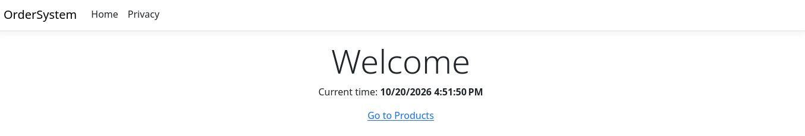

# OrderSystem

## Опис

### Базовий ASP.NET Core MVC-проєкт для лабораторної роботи.

### Реалізовано:

- HomeController з Index action;

- відображення поточного часу через ITimeService;

- реєстрацію сервісу через Dependency Injection;

- middleware для логування HTTP-запитів;

- головну сторінку з посиланням на Products.

## Вимоги

### .NET SDK 10.

Перевірка SDK:

```
dotnet --info
```

## Запуск

### Перейдіть у папку проєкту:

```
cd OrderSystem
dotnet restore
dotnet run
```
### Робоча гілка лабораторної: lab1.

## Результат
